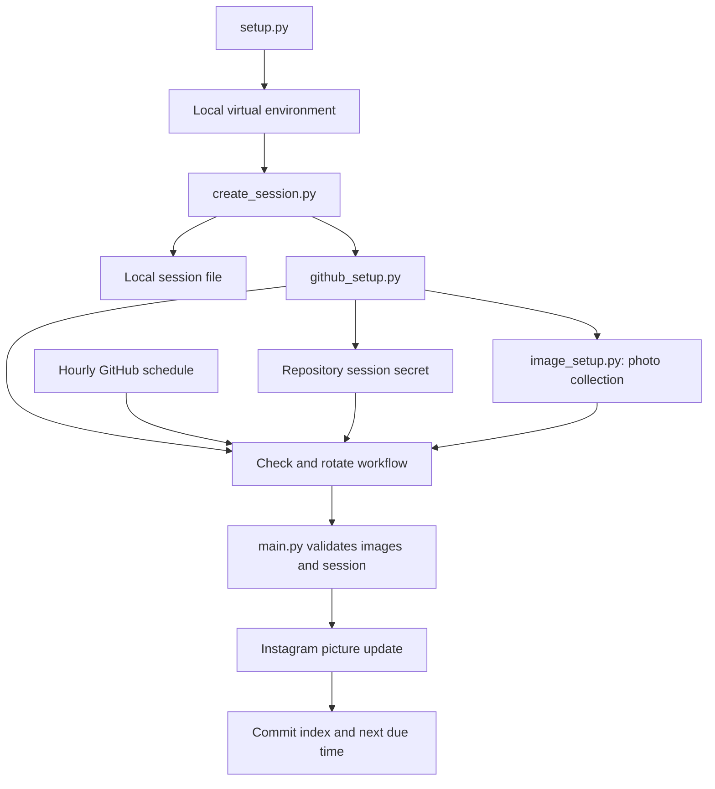

# How the project works

The local wizard prepares credentials and repository contents. GitHub Actions later uses those saved inputs to rotate pictures without the user's computer.

## Local setup

`setup.py` creates `.venv`, installs pinned requirements, and launches the wizard. `create_session.py` handles password, browser-cookie, or trusted local-session authentication. An authenticated account read validates the session before it is saved.

`terminal_ui.py` supplies interactive menus, masked input, and sanitized login progress. Basic prompts remain available when terminal capabilities are missing.

`github_setup.py` installs or locates GitHub CLI, signs in, discovers copies, selects a repository, saves the secret, and dispatches workflows. Discovery failure is distinct from finding no copies. Repository admin permission is required for setup.

## Photo replacement

`image_setup.py` verifies the complete collection before uploading. It creates Git blobs, a tree, and a commit, then updates the default-branch reference without force. The commit replaces supported top-level images and resets the index together. A conflicting branch update can prevent publication; uploaded blobs alone do not replace the active collection.

## Automated runs

`main.py` validates every image before contacting Instagram, loads the session, and validates account access. Check mode stops there. Rotation changes one picture and only then advances the index.

The workflow chooses the next random due time after a successful rotation and commits both state files. Runs share a concurrency group and are not cancelled by newer runs. The source template and non-default branches are excluded by the job guard.

A successful Instagram change followed by a failed Git push can leave remote state behind the actual picture. The workflow is not a transaction across Instagram and GitHub. Inspect failed steps before requesting another rotation.

See [Configuration](Configuration.md) for inputs, [Scheduling](Scheduling.md) for timing, and [Development](Development.md) for tests.
